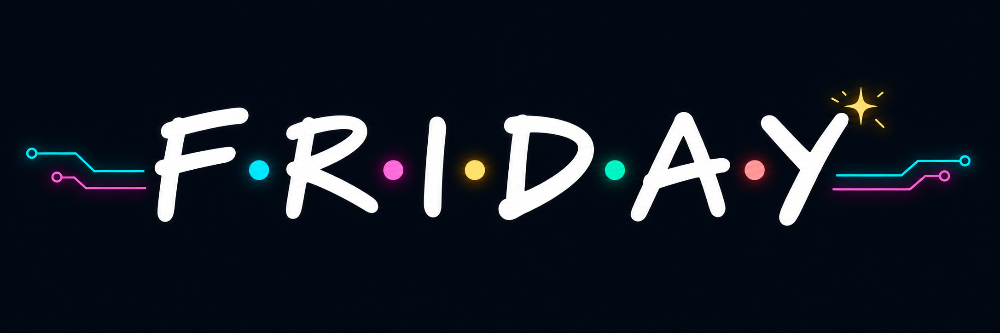

<p align="center">
  
</p>

<h1 align="center">Friday</h1>

<p align="center"><strong>Личный AI-помощник разработки, который приближает пятницу.</strong><br>
От задачи до проверенного чернового PR — с моделями, инструментами и правилами вашего проекта.</p>

<p align="center">Python 3.9+ · macOS / Linux · <a href="LICENSE">MIT</a> · ранняя версия</p>

---

Friday помогает вести разработку: готовит рабочую копию, составляет план, привлекает подходящих агентов, выполняет проверки и сохраняет результаты. Настройки проекта остаются локальными, а управление доступно из CLI и через навыки для Codex и Claude Code.

## Что умеет

- **Собрать команду.** Диспетчер выбирает роли и запускает настроенные модели Claude, Codex и Z.ai для исследования, разработки и ревью.
- **Взять задачу в работу.** Читать Yandex Tracker и GitHub Issues, работать по постановке и учитывать правила проекта через профиль.
- **Довести до черновика.** Готовить отдельную ветку, выполнять этапы и проверки, создавать draft PR в GitHub или черновой MR в GitLab и разбирать замечания.
- **Проверить локально.** Запускать изолированный гейт в Docker и, при соответствующей настройке, браузерную проверку на локальном стенде или с разрешённым staging API.
- **Помнить контекст.** Хранить карточки задач, журнал и доказательства локально; профили проектов не входят в репозиторий.

```text
Задача или постановка → план → агенты → проверки → черновой PR / MR → замечания
```

Автономная доставка включается в профиле. Friday не сливает PR/MR и не развёртывает приложение. Это ранняя версия: перед использованием ознакомьтесь с [границами работы](docs/guide.md#границы-текущей-версии) и настройте изоляцию под свой проект.

## Быстрый старт

Нужны Python 3.9+, Git и локальный checkout Friday. Для изолированных проверок нужен Docker; запуск модельных агентов через встроенные ограниченные адаптеры поддерживается на macOS. Для интеграций понадобятся соответствующие CLI и авторизация.

```sh
git clone git@github.com:avocawo/friday.git
cd friday
./bin/friday --help

# Скопируйте пример и укажите путь к своему репозиторию.
mkdir -p profiles
cp -n examples/project-profile.json profiles/example.json
./bin/friday clock-in TASK-1234 --profile profiles/example.json
```

Пример профиля создаёт только локальную карточку. Чтобы Friday мог разрабатывать и публиковать черновики, настройте рабочие копии, раннеры, проверки и нужные интеграции в [руководстве](docs/guide.md). Состояние по умолчанию находится в `~/.local/share/friday`; его можно перенести через `FRIDAY_HOME`. Секреты задаются отдельно от профилей.

### Плагин для Codex и Claude Code

Из каталога Friday зарегистрируйте локальный marketplace и установите плагин:

```sh
codex plugin marketplace add "$PWD"
codex plugin add friday@friday
claude plugin marketplace add "$PWD"
claude plugin install friday@friday --scope user
```

Начните новую сессию клиента. Плагин использует локальный CLI: добавьте `bin` в `PATH`, задайте `FRIDAY_BIN` или храните checkout в `~/Projects/friday`. [Подробнее об установке](docs/guide.md#плагин-для-codex-и-claude-code).

## Команды с пятничным настроением

| Команда | Назначение |
| --- | --- |
| `clock-in` | Создать карточку задачи и подготовить рабочую копию |
| `home-stretch` | Выполнить план и настроенную автономную доставку |
| `long-weekend` | Работать по постановке или выбирать задачи из GitHub-бэклога |
| `keep-watch` | Следить за задачами и обрабатывать замечания |
| `take-stock` | Посмотреть задачи и то, что требует внимания |
| `wrap-up` | Собрать критерии приёмки и результаты проверок |

Полный список — в `./bin/friday --help`, настройки и примеры — в [руководстве](docs/guide.md).

## Разработка

```sh
docker build -f Dockerfile.test -t friday-test:local .
./bin/test-offline
```

Тесты запускаются с синтетическими данными в контейнере без сети. Сборка образа может потребовать доступ к реестру образов. Часть тестов, которым нужен Docker внутри Docker, в этом режиме пропускается.

[Руководство](docs/guide.md) · [Исследование](docs/research.md) · [Участие в разработке](CONTRIBUTING.md) · [Лицензия](LICENSE)
